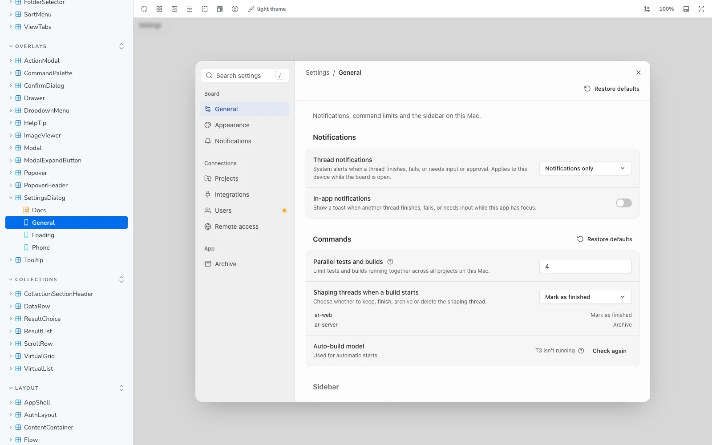

<h1 align="center">lar-web</h1>

<p align="center">The shared web foundation behind every Lar web app.</p>

<p align="center">
  <a href="https://maddec01.github.io/lar-web/"><strong>Storybook</strong></a> ·
  <a href="https://www.npmjs.com/package/@lar-works/design-system">@lar-works/design-system</a> ·
  <a href="https://www.npmjs.com/package/@lar-works/config">@lar-works/config</a>
</p>

<p align="center">
  <a href="https://maddec01.github.io/lar-web/">
    <picture>
      <source media="(prefers-color-scheme: dark)" srcset=".github/readme/storybook-dark.webp">
      
    </picture>
  </a>
</p>

One design system, one set of toolchain settings and one app template, so every Lar web app looks, reads and
builds the same way. Change a component here once and each app picks it up with a version bump.

## What's inside

- **[`@lar-works/design-system`](packages/design-system)**: tokens, base styles and accessible React
  components, from buttons to settings dialogs, so apps compose screens instead of rebuilding them. Browse
  every component and state in [Storybook](https://maddec01.github.io/lar-web/).
- **[`@lar-works/config`](packages/config)**: shared lint, format, TypeScript and test settings for
  [Vite+](https://viteplus.dev), so every app follows the same rules with one import.
- **[`templates/app`](templates/app)**: a ready-to-run React app wired to both packages, with routing,
  localization, theming and tests, so a new app starts from a working base.

## Install

Add the packages to an existing app:

```sh
pnpm add @lar-works/design-system
pnpm add -D @lar-works/config
```

Each package's README shows the setup. To start a new app from the template, clone this repository and run:

```sh
node scripts/create-app.mjs ../my-app --name my-app
```

## Contributing

See [CONTRIBUTING.md](CONTRIBUTING.md) for local development and how releases ship.

## License

The published packages are MIT licensed.
